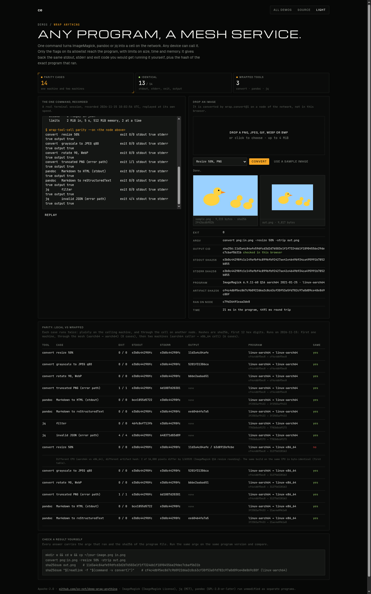

# Wrap anything

Any command-line program becomes a mesh service in one command. This repo wraps three:

| cell | program | license of the program |
|---|---|---|
| `wrap.convert@1` | ImageMagick `convert` | ImageMagick License (permissive) |
| `wrap.pandoc@1` | pandoc | GPL-2.0-or-later (run unmodified as a separate program, not shipped here) |
| `wrap.jq@1` | jq | MIT |

Any device on the network calls `Run{args, input, in_ext, out_ext}` and gets back the exit code, stdout, stderr,
the output file, `output_cid` (`sha256:<hex>` of the output, the address ce-blob stores it under), the exact `argv`
that ran, and the sha256 of the program file that ran it. So you can run the same argv on the same build yourself
and compare hashes.



Page: `web/` (published at ce-net.com/demos/wrap): the recorded one-command session, a drop zone that converts an
image through `wrap.convert@1`, and the parity table.

## Results (2026-11-15)

The parity test runs every case twice: plainly on the calling machine, and through the cell on a node over the
mesh. It compares stdout, stderr and the output file by sha256, and the exit code.

- **One machine, through the mesh (aarch64 to aarch64): 8 of 8 identical**, error paths included (a truncated PNG
  exits 1 with the same stderr, invalid JSON exits 4 with the same stderr). [docs/parity-same-node.md](docs/parity-same-node.md)
- **Two machines (aarch64 caller, x86_64 cell): 5 of 6 identical.** Same ImageMagick 6.9.11-60 and pandoc 3.6.4,
  different CPU, so a different artifact hash. JPEG, WebP, the error path and both pandoc cases match byte for byte.
  The PNG resize differs: 2 of 16,000 pixels differ by 1/65535 (Q16 resize rounding). The artifact hash in each
  answer tells you this up front: compare against the same build. [docs/parity-cross-device.md](docs/parity-cross-device.md)
- In a browser (headless Chromium, through wire.ws-door): the sample image came back as
  `sha256:11d3a4c84afe…`, the same CID as the plain local run, checked in the browser.

## Run it in under 5 minutes

You need Rust and ImageMagick (`apt install imagemagick`, `brew install imagemagick`). jq and pandoc are optional.

```sh
git clone https://github.com/ce-net/demo-wrap-anything && cd demo-wrap-anything
cargo test --release                       # the allowlist and the limits (7 tests, about a minute)
cargo run --release -- local convert --in tests/fixtures/ducks.png --out-ext png --out /tmp/out.png \
  -- '{in}' -resize 50% -strip '{out}'
```

`wrap-tool local` runs the argv a cell would run and prints its hashes:

```
# argv ["convert", "png:in.png", "-resize", "50%", "-strip", "out.png"]
# exit 0
# output sha256:11d3a4c84afe59dfcd3d2d76503e1f1f73246b1f18904556e29dec7cbaf5b31b
# artifact sha256 cf4c4db9… Version: ImageMagick 6.9.11-60 Q16 aarch64 (linux-aarch64)
```

On Debian 12 aarch64 you get the same output CID the cell returned. On another build, the artifact hash differs
and so may a resized PNG.

### As a cell on your own node

With a ce node running on the machine (its door on this machine), and access to the ce-wire crates:

```sh
(cd cell && cargo build --release)
bin/wrap-up convert        # the one command: systemd --user unit, health check, prints what it serves
bin/wrap-up pandoc; bin/wrap-up jq
cell/target/release/wrap-tool-cell parity --on <node> --md parity.md
node web/serve.mjs 8977    # the page, with /wire piped to this machine's wire.ws-door
```

## How it is safe to expose

Each tool has a policy, `tools/<tool>.toml`, which is plain data:

- **Allowlist.** Only the listed flags. Each value has a kind (`geometry`, `int:1:100`, `enum:Gray|sRGB`,
  `text:256:<words not allowed>`). `{in}` and `{out}` are the only file names: `in.<ext>` and `out.<ext>` in a fresh
  directory.
- **Input checks.** The input is checked against its magic bytes, and ImageMagick gets an explicit coder prefix
  (`png:in.png`), so no other coder (MVG, MSL, SVG, URL) can read it. pandoc always runs with `--sandbox`. A jq
  filter may not use `import`, `include`, `modulemeta` or `input_filename`.
- **Empty environment.** The program gets an empty environment plus the policy's own variables (ImageMagick
  resource limits).
- **Limits.** Input size, output size, stdout and stderr size, wall-clock time (the whole process group is killed),
  CPU seconds, data memory, open files, and runs at a time.
- **ce-cap gate.** Every op needs its own right (`wrap.convert:run`), default deny. A browser holds a short-lived
  grant minted by wire.ws-door, for `run` and `describe` only.

## Layout

| path | what |
|---|---|
| `crates/wrap-tool` | the policy, the allowlist, the limited exec, `wrap-tool local` (crates.io dependencies only) |
| `cell/crates/wrap-tool-api` | the typed API of the three cells (`ce_wire::api!`) |
| `cell/crates/wrap-tool-cell` | `serve <tool>` behind the door, and `parity` |
| `sdk/json`, `sdk/ts-web` | descriptors and browser clients, generated by `ce-wire-gen` |
| `tools/*.toml` | the three policies |
| `web/` | the page, `serve.mjs`, the recording and the parity data it shows |

Gaps: the cell workspace builds against the ce-wire and ce-gate crates, which are not public yet, so outside the
network only `wrap-tool local` and the page build. The public page needs a public wss:// door before strangers can
drop images; until then the drop zone works with a grant link from a node owner.

Apache-2.0.
